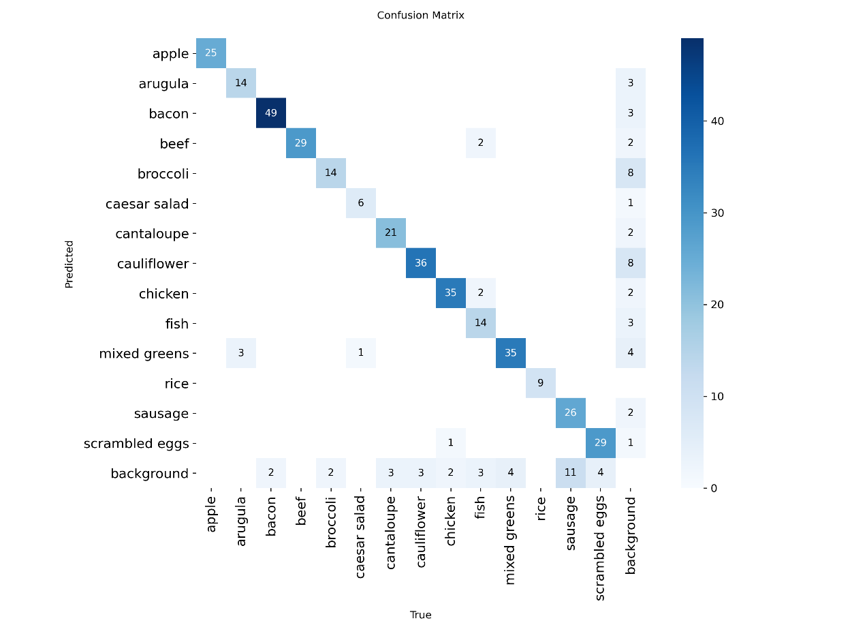
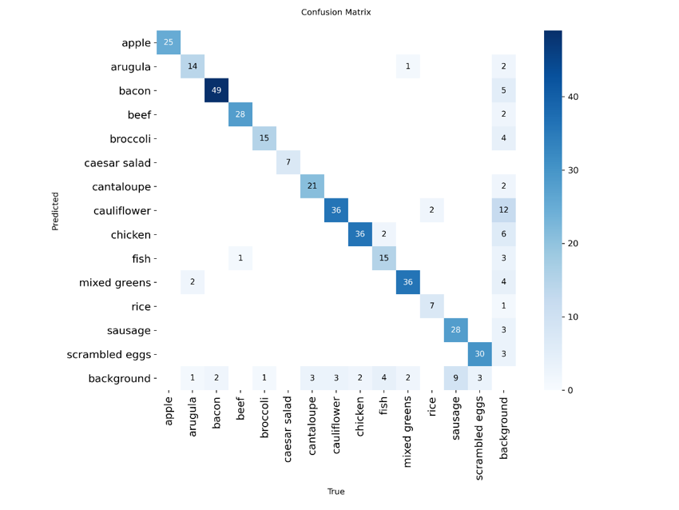
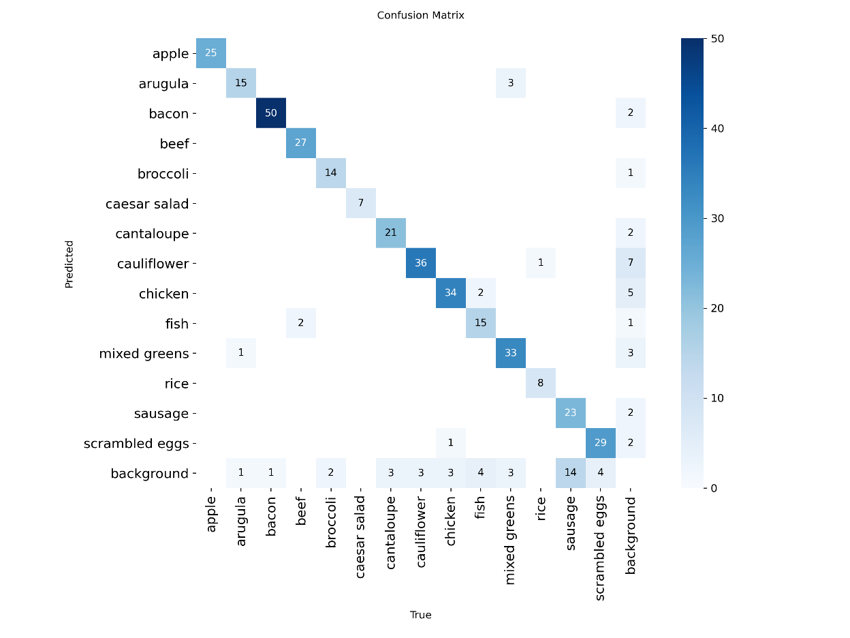
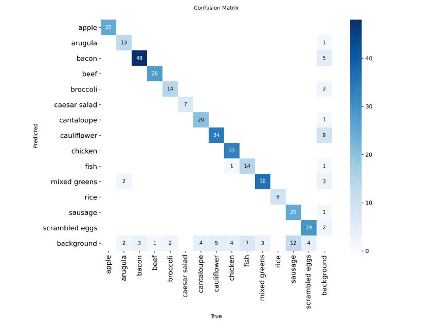
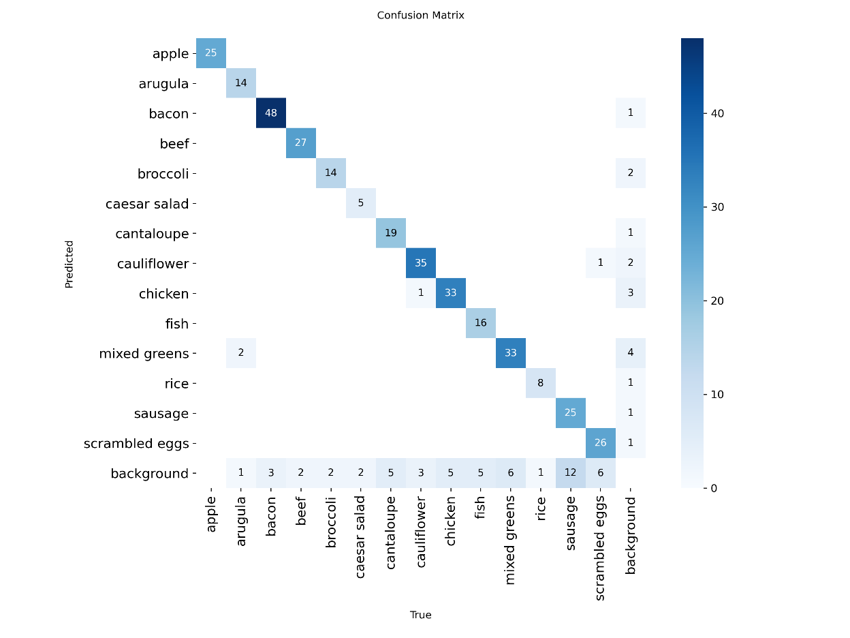

### Mixed Rice Detection Models

This repository is based on Ultralytics v8.3.252, and adds a mass regression head to YOLOv11, YOLOv12 and RT-DETR. Other than bounding boxes and class, each detection will include a mass value that predicts a food item's mass in grams. It is also modified to include E-IRFS resampling technique to deal with class imbalances.

## Results

All results are on the test set. Latency is inference time per image on an NVIDIA Tesla T4. **Bold** marks the best value in each row.

**Table 1.** Channel-specific models (one mass output per class)

| Metric              | YOLOv11-l     | YOLOv12-l | RT-DETR-l     |
|---------------------|:-------------:|:---------:|:-------------:|
| Precision           | **93.67%**    | 93.17%    | 92.76%        |
| Recall              | 84.85%        | 86.55%    | **89.33%**    |
| F1-score            | 89.04%        | 89.74%    | **91.01%**    |
| mAP50    | **93.02%**    | 92.81%    | 91.24%        |
| mAP50-95 | **87.33%**    | 86.03%    | 81.54%        |
| Mass MAE (g)        | 14.13         | 15.32     | **13.26**     |
| Latency (ms)        | **32.8**      | 47.3      | 40.9          |

<b>Confusion matrices for channel-specific models</b>

 

*Figure 1. YOLOv11-l, channel-specific.*

*Figure 2. YOLOv12-l, channel-specific.*

*Figure 3. RT-DETR-l, channel-specific.*

**Table 2.** Channel-agnostic models (one shared mass output)

| Metric              | YOLOv11-l     | YOLOv12-l     | RT-DETR-l     |
|---------------------|:-------------:|:-------------:|:-------------:|
| Precision           | 90.77%        | 91.54%        | **92.72%**    |
| Recall              | 88.54%        | **88.76%**    | 87.03%        |
| F1-score            | 89.64%        | **90.13%**    | 89.78%        |
| mAP50    | **93.27%**    | 92.90%        | 90.06%        |
| mAP50-95 | 86.30%        | **87.09%**    | 80.76%        |
| Mass MAE (g)        | 16.01         | 14.84         | **12.91**     |
| Latency (ms)        | **33.5**      | 48.4          | 45.6          |

<b>Confusion matrices for channel-agnostic models</b>

 

*Figure 4. YOLOv11-l, channel-agnostic.*

*Figure 5. YOLOv12-l, channel-agnostic.*

*Figure 6. RT-DETR-l, channel-agnostic.*

## Changes
- Added the mass value to each label. Changed the default label format checks to accept a sixth mass column (data/utils.py), checked that every label carries mass (data/base.py), and included the mass label in loading (data/dataset.py), through augmentation (data/augment.py) and in the results (engine/results.py).
- Added a mass regression head (nn/modules/head.py): a separate mass branch for YOLO, and encoder and decoder mass heads for RT-DETR. Each model has a channel-specific version (one mass output per class) and a channel-agnostic version (one shared mass output).
- Added a loss function for mass (models/utils/loss.py for RT-DETR and utils/loss.py for YOLO models). RT-DETR uses L1 loss on the predictions matched to ground-truth objects.
- Applied a custom loss function for YOLO models that increases agreement in mass prediction between the anchors of an object. It also ensures that the average anchor mass of each object, summed over all objects of the same class in an image, matches that class's ground-truth mass. Adapted from the instance-level and bag-level loss functions of Javanmard et al. (2024) [1]. The formula is shown below.
- Capped the gain of the agreement term at 0.15 to prevent it from dominating the bag-level loss.
- Modified the BaseValidator class to store the mass error of each matched prediction at every validation epoch, to calculate the mass MAE (engine/validator.py).
- Modified the fitness function to include mass (utils/metrics.py).
- Implemented E-IRFS for training only (data/dataset.py, data/build.py).

## YOLO mass loss
In YOLO family of models, there are several positive anchors assigned to one object as it is a dense prediction model. Thus, to reduce bag-level losses and at the same time increase the agreement between anchor boxes for each anchor point, an instance-level loss function was adapted for our task (Javanmard et al., 2024).

For object $i$ with $N_i$ positive anchors, where $p_{i,k}$ is the mass predicted by anchor $k$, the object's mass is the average of its anchors:
 
$$
\bar{p}_i = \frac{1}{N_i} \sum_{k=1}^{N_i} p_{i,k}
$$
 
The standard deviation of anchor predictions within each object, averaged over all $M$ objects:
 
$$
\mathrm{Std} = \sqrt{ \frac{1}{M} \sum_{i=1}^{M} \left( \frac{\sum_{k=1}^{N_i} p_{i,k}^2}{N_i} - \bar{p}_i^{\,2} \right) }
$$
 
For each class $c$ in an image, the masses of its $N_c$ objects are summed and compared with the class's ground-truth mass $y_c$. The mean absolute error is calculated over all (predicted, ground truth) pairs for labels of ground truth objects:
 
$$
l_{bag} = \mathrm{MAE}\left( \sum_{i=1}^{N_c} \bar{p}_i ,\; y_c \right)
$$
 
The bag-level loss is multiplied by a mass gain $\lambda$. The standard deviation term is multiplied by $g$ (value depends on the bag-level loss):
 
$$
l_{mass} = \lambda \ l_{bag} + g(\lambda \ l_{bag}) \cdot \mathrm{Std}
$$
 
$$
g(x) = \min\left( \max\left( 2.1^{-(x + 0.45)} - 0.47,\; 0.00 \right),\; 0.15 \right)
$$
 
$g$ is zero while the bag-level loss is large, and is capped at 0.15. This is to ensure that the model focuses on reducing bag-level loss first before reducing $\mathrm{Std}$. The 0.15 cap prevents $\mathrm{Std}$ from dominating the loss gradient.

## E-IRFS
To deal with class imbalance problem, E-IRFS sampling technique is employed.

Each class $c$ gets a weight $w_c = \exp\left(a\sqrt{t / \sqrt{f_{img}(c) \cdot f_{box}(c)}}\right)$, with $a = 2.0$ and $t = 0.05$. $f_{img}(c)$ is the fraction of images containing class $c$, $f_{box}(c)$ is the fraction of boxes of class $c$ out of all boxes.

## Main Branches
| Branch | Model | Mass head |
|---|---|---|
| `master11_newdata` | YOLOv11 | Channel-specific |
| `master12_newdata` | YOLOv12 | Channel-specific |
| `mastersingle11_newdata` | YOLOv11 | Channel-agnostic |
| `mastersingle12_newdata` | YOLOv12 | Channel-agnostic |
| `rtdetr_newdata` | RT-DETR | Channel-specific |
| `rtdetrsinglechannel_newdata` | RT-DETR | Channel-agnostic (best model) |

## Limitations
- Contains print statements for debugging in the codebase.
- One branch per variant, a better design is to override base classes for different variants so that the same branch works for all models.
- No automated test.

## References
1. A. Javanmard, L. Chen, V. Mirrokni, A. Badanidiyuru and G. Fu. *Learning from Aggregate Responses: Instance Level versus Bag Level Loss Functions.* ICLR 2024. [arXiv:2401.11081](https://arxiv.org/abs/2401.11081)
2. T. Ahmed, A. Kumar, C. Álvarez Casado, A. Zhang, T. Hänninen, L. Loven, M. Bordallo López and S. Tarkoma. *Exponentially Weighted Instance-Aware Repeat Factor Sampling for Long-Tailed Object Detection Model Training in Unmanned Aerial Vehicles Surveillance Scenarios.* arXiv, 2025. [arXiv:2503.21893](https://arxiv.org/abs/2503.21893)

## License
AGPL-3.0, inherited from [Ultralytics](https://github.com/ultralytics/ultralytics). See LICENSE. The modifications described above are my own.
